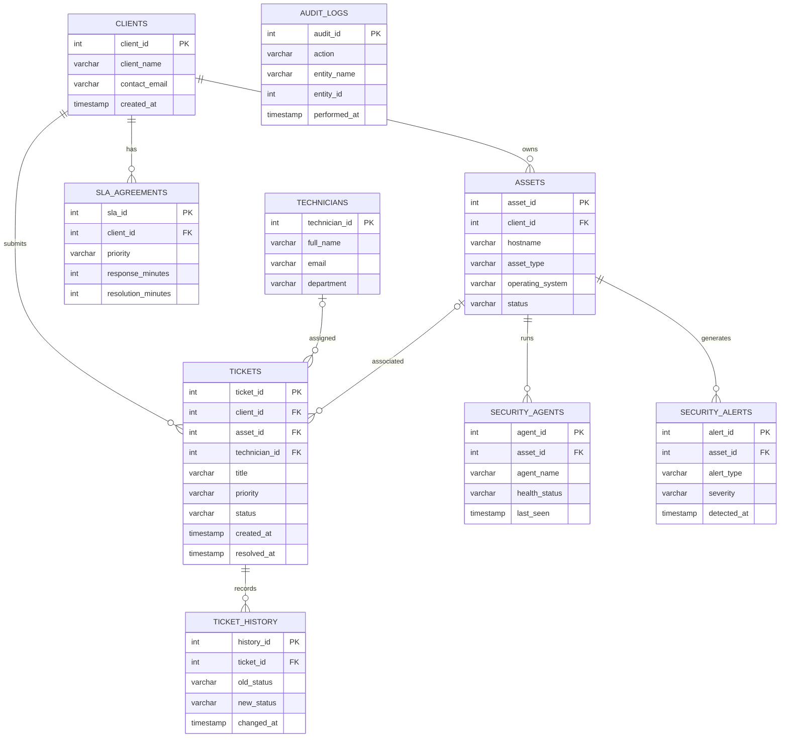

# Sotai Digital Solutions
## Enterprise IT Service Management and Asset Monitoring System

### Entity Relationship Diagram

### Description

The database contains nine entities supporting IT service
management, asset monitoring, security tracking, and auditing.

Primary keys uniquely identify records, while foreign keys
maintain referential integrity between related entities.

The audit_logs table is standalone in the current schema.
